# TechQA RAG MLOps Platform — 逐步執行手冊 (Execution Playbook)

> **版本** v1.0 | **日期** 2026-11-24 | **專案狀態** 尚未實作（本文件是計畫，不代表程式碼已存在）  
> **閱讀順序** `PROJECT.md`（規格/決策） → **`EXECUTION_GUIDE.md`（唯一執行順序）** → `TASK_TRACKER.md`（狀態） → `AGENTS.md`（Codex/Agent 約束）  
> **硬體** Windows + RTX 3060 Ti（通常 8GB VRAM）；優先 WSL2 Ubuntu + Python + Docker。  
> **範圍** NVIDIA `nvidia/TechQA-RAG-Eval`、Retrieval 模型微調、MLflow、受控部署與監控；Kubernetes / Multi-Agent 不在首版 MVP。  
> **保守原則** 原始 TechQA 是 **RAG 評估資料集**；其 Hub `train` split **不是可直接拿來訓練且同步測試的保證**。先稽核標註與資料洩漏風險，通過 Gate 再微調。

---

## 0. 使用方式：避免一直問 AI 問到專案失控

本文件是**執行順序的唯一來源**。不要每次看到新工具就把架構改掉。依據下列規則推進：

1. **同一時間只做 1 個 Task ID**；完成並留下證據才勾選 `TASK_TRACKER.md`。
2. 每次開始，先看 `TASK_TRACKER.md` 的「目前任務 / Blocking / 下一步」。
3. 請 Codex 寫程式時，指派**一個** Task ID，給清楚驗收條件；不要求它一次做完整 Sprint。
4. 任務完成後必須有（a）程式碼及文件（b）可重跑的驗收命令（c）實際輸出/測試（d）Git commit（e）追蹤表更新。
5. **不能跳過資料標籤可信度檢查**；不能把沒有 label 的資料假裝有 ground truth；不能把期望指標當測試結果。
6. 若發現原計畫不合理，新增一筆 `docs/DECISIONS.md`（ADR），寫明替代方案、理由、對後續 Sprint 的影響；不要默默改全專案。
7. 每週收尾提交 `reports/weekly/Wxx.md`，包含「做了什麼、能否重跑、證據、卡點、下週唯一優先事項」。

### 0.1 四種文件各做什麼？

| 文件 | 用途 | 什麼時候改 |
|---|---|---|
| `PROJECT.md` | 專案 WHY/WHAT：目標、架構、資料合約、整體技術選型 | 重大設計決策變動 |
| `EXECUTION_GUIDE.md` | HOW：每週按什麼順序做、具體檔案與 Gate | 作法修訂時，需留版本紀錄 |
| `TASK_TRACKER.md` | NOW：下一件事、完成狀態、實際證據 | **每完成一件事就更新** |
| `AGENTS.md` | Codex/AI coding agent 能做什麼、不能做什麼、交付格式 | 開發規範變動 |

### 0.2 約定的狀態與任務格式

- 狀態：`TODO` / `IN_PROGRESS` / `BLOCKED` / `DONE`。
- 每項任務命名：`ENV-001`、`DATA-001`、`RET-001`、`TRAIN-001`、`OPS-001` 等。
- 一個 Task 的報告格式：**目的 → 前置條件 → 需要改哪些檔 → 具體操作 → 驗收命令 → 實際結果/連結 → 風險/下一步**。
- 程式碼路徑皆以 repo root 為準；下方指令中的檔案若尚未建立，**是預定的工作產物，直接執行會失敗**。先完成對應 Task。

---

## 1. 到底在做什麼？從使用者問題到可量化成果

### 1.1 產品行為（最終 Demo）

使用者輸入英文 IBM 技術支援問題 → 系統從 TechQA 技術文件找到相關證據 → optional reranker → 回傳答案及引用。**主模型訓練對象是 Retriever Embedding；Generator 先不微調。**

```text
Input: "How do I resolve [technical problem]?"
  ↓ normalize query
BM25 / Dense / Hybrid retrieval
  ↓ top-10 evidence candidates
(optional) CrossEncoder reranker
  ↓ top-3 context chunks
Generator (existing model/API) OR retrieval-only evidence display
  ↓
Output: answer + citations + trace_id + model_version + index_version
```

### 1.2 不要搞混三個成果

1. **ML 任務：** 排序技術文件片段；量化 `Recall@K / MRR@10 / nDCG@10`。
2. **產品任務：** 在可信證據下回答；衡量引用正確率、可回答性、延遲。
3. **MLOps 任務：** 資料可版本化、訓練可重現、實驗可比較、新模型有 release gate、部署可回滾。

### 1.3 成功定義（不是宣稱達標的數字）

- `reproducibility`: 可由 Git commit + config + dataset snapshot 重新執行 baseline 和訓練。
- `comparability`: BM25、原始 embedding、hybrid、fine-tuned embedding 使用**同一份固定 evaluation policy**。
- `promotion`: 品質或安全性不過關時，舊模型和舊 index 仍在線上。
- `rollback`: 能切回上一個 **model + vector index + chunker config** 的版本組合。
- `evidence`: README 展示真實 metrics、指令、測試、MLflow run，而非單純 UI 截圖。

---

## 2. 任務依賴總圖與停止條件

```mermaid
flowchart LR
 E[ENV-001 開發環境] --> R[REPO-001 Repo skeleton]
 R --> D1[DATA-001 TechQA 稽核]
 D1 --> G1{GATE A: 標註可信?}
 G1 -->|否| L[DATA-003 人工審核或引入獨立訓練資料]
 L --> D2[DATA-002 正規化/切分]
 G1 -->|是| D2
 D2 --> D3[DATA-004 DVC snapshot]
 D3 --> B[RET-001/002/003 基線]
 B --> G2{GATE B: 評估可信?}
 G2 -->|否| L
 G2 -->|是| T[TRAIN-001 Embedding 微調]
 T --> V[EVAL-001 固定評估]
 V --> M[OPS-001 MLflow + Registry]
 M --> G3{GATE C: 候選可發布?}
 G3 -->|否| Q[保留 active 版本]
 G3 -->|是| I[INDEX-001 重建索引]
 I --> S[SERVE-001 FastAPI/Docker]
 S --> O[MON-001 Metrics/Feedback]
 O --> CT[CT-001 人工審核+候選重新訓練]
```



**Gate A（最重要）**：若 `contexts[]` 並非可驗證的 relevant evidence，不能做可信的 retriever evaluation；先建立小型人工審核集。  
**Gate B**：baseline 在固定 corpus / split / qrels 上可以重跑，且 qrels 不從模型輸出反推。  
**Gate C**：新模型與新索引配對驗證通過，才可切換 Active Release。

---

## 3. 預定 Repository 結構與檔案責任

```text
techqa-rag-mlops/
├── README.md                  # 使用者入口、Demo、真實結果（後期更新）
├── PROJECT.md                 # 專案規格
├── EXECUTION_GUIDE.md         # 本文件
├── TASK_TRACKER.md            # 單一真實進度表
├── AGENTS.md                  # Codex 規範
├── pyproject.toml / uv.lock   # 依賴與鎖定版本
├── Makefile                   # 常用命令入口
├── .env.example               # 無機密的環境變數模板
├── .gitignore
├── configs/
│   ├── data.yaml              # dataset snapshot、split、chunker 參數
│   ├── retrieval.yaml         # BM25、dense、hybrid、top-k
│   ├── training.yaml          # model revision、batch、epochs、seed
│   └── release.yaml           # gate / release policy
├── data/
│   ├── raw/                   # 來源快照，Git 忽略，DVC 追蹤
│   ├── processed/             # 正規化/切分（DVC）
│   └── feedback/              # 审核後新標籤（DVC）
├── src/techqa_mlops/
│   ├── data/                  # audit, normalize, split, chunk
│   ├── retrieval/             # BM25, dense, hybrid, qdrant
│   ├── training/              # embedding train, later reranker
│   ├── evaluation/            # retrieval metrics, leakage tests
│   ├── registry/              # MLflow + release bundles
│   ├── api/                   # FastAPI route / schemas
│   └── monitoring/            # metrics, redacted feedback
├── scripts/                   # 明確的 CLI 入口
├── tests/
│   ├── unit/
│   ├── integration/
│   └── fixtures/              # 極小匿名 fixture，不含完整語料
├── infra/
│   ├── docker-compose.yml
│   ├── prometheus.yml
│   └── grafana/
├── reports/
│   ├── dataset_audit.md
│   ├── baseline_results.md
│   ├── experiment_comparison.md
│   ├── release_evidence.md
│   └── weekly/
├── artifacts/                 # model/index manifests，本地大檔不進 Git
├── docs/
│   ├── DECISIONS.md
│   ├── DATA_CONTRACT.md
│   ├── EXPERIMENT_PROTOCOL.md
│   ├── RUNBOOK.md
│   └── API.md
└── .github/workflows/
    └── ci.yml
```

**注意**：這是最終目標目錄。Sprint 1 只建最少的檔案；不要先產生一堆空模組假裝完工。

---

## 4. 執行環境：第一天就確認（ENV-001 / ENV-002 / REPO-001）

### 4.1 Windows 與 WSL2 的邊界

- Windows PowerShell 管理 WSL2；開發程式、Python、DVC、Git、測試主要在 **WSL2 Ubuntu shell** 執行。
- 建議 repo 放在 WSL 的 Linux 檔案系統 `~/projects/techqa-rag-mlops`，避免大型資料 IO 放在 `/mnt/c`。
- 使用 Windows 端 NVIDIA 驅動 + WSL2 CUDA 支援；**不要在 WSL 裡重複安裝 Linux NVIDIA kernel driver**。
- Docker Desktop 啟用 WSL2 integration；若 Docker GPU 尚未支援，**先做 CPU data/retrieval 工作**，不要讓環境問題卡住資料稽核。
- 若用原生 Ubuntu 而非 WSL2，依官方驅動與 Docker 指引處理，不要套 Windows 專用步驟。

### 4.2 先做的環境檢查

**Windows PowerShell（系統檢查，可用時）**：

```powershell
wsl --status
wsl --list --verbose
nvidia-smi
```

**WSL2 Ubuntu shell**：

```bash
uname -a
python3 --version
git --version
nvidia-smi       # 若 WSL GPU passthrough 正常，應看到 NVIDIA GPU
docker version    # Docker Desktop/daemon 就緒後測
docker compose version
```

**基本 Python 驗證（建立 Python 環境並安裝對應 PyTorch 版本後才可執行）**：

```bash
python -c 'import torch; print("cuda:", torch.cuda.is_available()); print("device:", torch.cuda.get_device_name(0) if torch.cuda.is_available() else "CPU")'
```

**驗收證據**：`reports/environment.md` 記錄 OS、Python、Git、Docker、GPU、Torch 版本與指令結果（不得包含機密或完整主機個資）。

### 4.3 建立 repo 與最小環境（指令實例，實際版本由鎖檔固定）

```bash
mkdir -p ~/projects/techqa-rag-mlops
cd ~/projects/techqa-rag-mlops
git init
python3 -m venv .venv
source .venv/bin/activate
python -m pip install --upgrade pip
python -m pip install datasets huggingface_hub pandas pyarrow pytest ruff pyyaml
mkdir -p configs scripts tests/unit reports/weekly docs data/raw data/processed
```

後續在 `REPO-001` 把依賴搬到 `pyproject.toml` + `uv.lock` 或 `requirements.lock`。上面 `pip install` 是**開發啟動命令，不是最後版本鎖定方案**。大檔、API keys、`.env` 不得 commit。

**ENV Done when**：GPU 可用或清楚記錄暫時不可用的原因；Python/Docker 與 Repo 啟動成功。  
**REPO Done when**：有 README、`.gitignore`、格式檢查、簡單 `pytest` smoke test、第一次 Git commit。

---

## 5. Week 1 — Dataset Audit：不要訓練模型（DATA-001 / DATA-003）

### 5.1 為什麼先 Audit？

NVIDIA TechQA dataset card 說約 908 問答，Hugging Face viewer 在 2026-11-24 顯示 `train` 910 rows，欄位為 `id`, `question`, `answer`, `is_impossible`, `contexts`。存在不一致，所以**以實際 pin 住的 revision 下載結果為準**；不要把 viewer 的 `train` 名稱誤讀成我們專案的合法 train/test split。

`contexts` 是候選證據，不是自動保證每筆都是人工驗證的 relevant document。`is_impossible=true` 的例子通常無可引用正確文件，應獨立評估 abstention；不可盲目當 positive pairs。

### 5.2 精確任務步驟

**DATA-001.1 — 保存來源與 revision**

1. 在 `configs/data.yaml` 填 `dataset_id: nvidia/TechQA-RAG-Eval`，revision 初期使用由 Hub API 查出的**完整 commit SHA**（不是 `main`）。
2. 撰寫 `scripts/inspect_dataset.py`：用 `huggingface_hub.HfApi().dataset_info(...).sha` 取得 revision，再用 `datasets.load_dataset(..., revision=sha)` 下載指定 snapshot。
3. 輸出前 2 筆**遮罩後**的欄位樹、`dataset.features`、`len(ds)`、每欄 null 分布到 `reports/dataset_audit.json`；**不要把整份 contexts 印進 log**。
4. 保存 raw snapshot、revision、檔案 SHA-256；用 `README` 註明取得日期與授權。

參考核心程式片段（需由任務實作成正式腳本，處理 exceptions、輸出與 hashing）：

```python
from datasets import load_dataset
from huggingface_hub import HfApi

name = "nvidia/TechQA-RAG-Eval"
revision = HfApi().dataset_info(name).sha
snapshot = load_dataset(name, revision=revision)
print("revision:", revision)
print("splits:", {k: len(v) for k, v in snapshot.items()})
print("features:", snapshot["train"].features)
```

**DATA-001.2 — 整理 QC 報告**

- `row_count`, `unique_ids`, duplicate `id`、duplicate question（正規化文字後）
- `is_impossible` 次數、空/缺失 `answer` 與空 `contexts` 次數
- `contexts` 每題數量、unique `filename`、unique context content hash
- 文件長度（min/median/p95/max）、極長文件、無法解碼字元
- 相同 context 出現在幾個問答；相似 question 是否跨相同來源文件
- 隨機抽取固定 seed 的 **20–30 筆可回答 + 10 筆不可回答** 作人工審核樣本（總數依資料分布調整）
- 審核欄位：`query_id`, `context_id`, `relevant_yes_no`, `answer_supported`, `reviewer`, `reason`

**DATA-001.3 — Gate A 檢查與決策**

- 審核樣本的 context 真能支持答案？支持比例、錯誤案例與混淆點寫入報告。
- 若可信：先標記 `source_context` 為**弱標籤**，用人審小集作獨立檢查，暫定 baseline。
- 若不可信：實作 `DATA-003`，建立**人工確認** qrels，或使用另一個有授權的訓練集；TechQA 則保留為獨立評估。**不得跳過 Gate A。**

**DATA-001 驗收**：`reports/dataset_audit.md` + `.json` + 固定 dataset revision + 抽樣審核證據 + 稽核測試。**看起來不漂亮的數據也要照實記錄。**

---

## 6. Week 2 — Normalization、Split、DVC（DATA-002 / DATA-004）

### 6.1 明確的資料轉換流程

1. 對 `contexts` 裡的文件以 `(source filename, normalized content hash)` 去重，產生 stable `doc_id`。
2. 將資料分離成 `documents.parquet`、`queries.parquet`、`qrels.parquet`；保留 label provenance。
3. `is_impossible=true` 無正確證據時，`qrels` 不產生虛假 positive；納入獨立 **unanswerable** 評估集。
4. 依**query → source-document 關聯**建立 group，讓重複/相似問題不跨 train/val/test；使用固定 `seed`，目標例如 70/15/15，實際以分組品質決定。
5. 記錄 `split_manifest.json`，防止後續重新分割造成測試集漂移。
6. 將 chunker 參數版本化：例如 `chunk_size=400`（以 tokenizer token 或 char 為單位，**明寫單位**）、`overlap=60`，觀察長文件與 citation offsets；這是起始假設，不是最佳參數。
7. 將檢索的評估方式定義清楚：`doc-level relevance` 與 `chunk-level relevance` **不能混算**。若只有 doc-level qrels，先評估「Top-K chunks 對應 doc_id 是否 relevant」，去重後報告 doc-level 指標；chunk-level 需人工建立 gold chunks。
8. 用 DVC 追蹤 raw + processed + manifests；Git commit DVC metadata 和 config，不 commit 大型 corpus。

### 6.2 DVC 基本命令（在環境與資料產物存在後執行）

```bash
dvc init
dvc add data/raw
dvc add data/processed
git add data/raw.dvc data/processed.dvc .dvc/config .gitignore
git commit -m "data: version audited TechQA snapshot"
```

> DVC remote 可以在 MVP 先用本地外部路徑備份；若想跨機器再設 MinIO/S3。**沒有 remote 時不能宣稱別人 clone 後可完整復現 dataset**。記錄重取來源的腳本與 pinned revision。

**驗收測試**：

- 每個 `query_id` 在單一 split；重複 questions 不跨 split。
- 沒有把 reference answer 泄漏進 retrieval query 或 negative mining。
- 同一份 source 的映射規則不會因資料列順序改變 ID。
- DVC 有 stage/metadata 且 `dvc status` 顯示預期結果。
- 固定 split 不因再次執行而改變（hash 比對）。

**Gate B 前置**：人工驗證集、qrels provenance、split policy、corpus policy 已寫入 `docs/EXPERIMENT_PROTOCOL.md`。

---

## 7. Week 3 — BM25 + 評估腳本（RET-001 / EVAL-001）

### 7.1 先有評估，再有 Fine-tuning

1. `src/techqa_mlops/retrieval/bm25.py`：以 **同一版本 chunk corpus** 建立 sparse index。
2. `src/techqa_mlops/evaluation/retrieval_metrics.py`：輸入 `query_id → ranked doc/chunk IDs` + qrels；計算 Recall@1/5/10、MRR@10、nDCG@10；當沒有 graded relevance 時說明二元 nDCG 定義。
3. 不把 unanswerable 問題強制算入「有 positive relevance 的 Recall」分母；另報告 unanswerable abstention/hallucination 相關指標。
4. `scripts/run_baseline.py --retriever bm25 --split val`，產生 `reports/baselines/bm25_val.json` 和排序輸出。
5. 建立 toy fixture（3–5 文件、2–4 query）手算 MRR/Recall 的單元測試。
6. 加上 structured run manifest（index version、corpus hash、chunker、query split、seed）。

**驗收**：命令反覆執行指標一致；排序有 ID 可追溯；metric unit tests 全通過。**尚不看 test split**。

---

## 8. Week 4 — Dense + Hybrid Baselines（RET-002 / RET-003）

1. 選定小型 English embedding（初始候選 `sentence-transformers/all-MiniLM-L6-v2`），**pin 模型 revision**，記錄 license、dim、max_length。
2. `embed_corpus.py` 將 chunks batch encode，保留 `chunk_id`、`doc_id`、`embedding_model_revision`、`index_version`。
3. Qdrant collection 命名如 `techqa_dense_<hash>`；不同 embedding model 及 chunker 建**新 collection**，不能直接覆蓋 active index。
4. `retrieve_dense.py` 查 top-K，量測 CPU/GPU encoding latency；資料量不大時可先用 in-memory dense index，等 Qdrant 集成再切換。
5. `retrieve_hybrid.py` 做 BM25 + dense（例如 Reciprocal Rank Fusion）；fusion 參數只在 validation 調。
6. 以一致的 val corpus、queries、qrels 比較 BM25 / Dense / Hybrid；輸出表格與錯誤分析 10 例。
7. 記錄 memory/GPU 使用；小模型優先，不追求最大 LLM。

**驗收**：三個 baseline 可一鍵重跑；每個有 index manifest；`reports/baseline_results.md` 實際數字。  
**Gate B**：若 qrels 仍不可信，先修資料，不得硬做 fine-tuning 宣稱有效。

---

## 9. Week 5 — Embedding Fine-tuning（TRAIN-001）

**核心問題**：讓技術問題向量更接近能提供答案的文件向量，而不是訓練 LLM 產生文字。

1. 準備 `train_pairs.parquet`：至少包含 `query_id`, `query`, `positive_doc_id/chunk_id`, `positive_text`, `label_source`；**僅可從 train split**。
2. 如果要 hard negatives，只從合法的訓練 corpus 中採樣，人工 spot check「負例」沒有其實也是相關內容；嚴禁 val/test qrels 進訓練。
3. 先對 **50–100 筆**做 smoke training，確定 CPU/GPU、loss、儲存、MLflow、評估腳本正常。
4. 小模型先用 MiniLM 類、`batch_size` 4–8 作探索（3060 Ti 8GB 視 max length 與實測 OOM 調整）；grad accumulation 視需要；固定 seed、fp16/bf16 能力先確認。
5. 以 `MultipleNegativesRankingLoss` 類或適當 contrastive objective 開始；注意 **in-batch negatives 的 false negatives**；可使用去重/label-aware batch sampler。
6. 記錄 model revision、dataset fingerprint、train group manifest、loss config、learning rate、epochs、seed、GPU driver、Torch/CUDA、Git commit。
7. 僅用 validation 選最佳 checkpoint；**禁止把 test 當作超參數搜尋依據**。
8. 比較 base embedding vs tuned embedding，保持 chunk corpus、candidate pool、metric 定義一致；重建 tuned model 的向量索引。

**驗收**：一條可重跑 training command、保存 model weights、MLflow run + config、val 指標及失敗案例；可以明確回答「微調是否有改善」，即使答案是否定的。  
**OOM 解法優先順序**：降低 per-device batch、降低 max_length、啟用 gradient accumulation、減少一次嵌入文件量、釋放其他 GPU 程序；必要時使用雲端 GPU，不必在第一版訓練大型模型。

---

## 10. Week 6 — MLflow Tracking、評估與 Registry（OPS-001 / EVAL-002）

1. 使用本地 MLflow tracking（先 local filesystem，需多人服務再加 PostgreSQL + artifact storage）；**不需要因為要學 MLOps 就第一天部署全套**。
2. 所有 baseline/training run 記錄 params、metrics、dataset manifest、Git revision、模型檔與索引描述檔。
3. `scripts/evaluate_candidate.py` 比較 candidate 與 active base：val 的 Recall@5/MRR@10/nDCG@10、unanswerable 行為、索引匹配、latency。
4. `configs/release.yaml` 記品質門檻；初期採**不退步 + 合法性要求**，不要在 baseline 前亂設過高的絕對分數。
5. 定義 `release_manifest.json`：`release_id`, `retriever_model_uri`, `model_revision`, `chunker_version`, `collection_name`, `corpus_sha256`, `evaluation_run_id`, `created_at`, `approval_status`。
6. 註冊模型，將通過 gate 的候選標記為 Candidate（依 MLflow 版本使用相容的 alias/stage 策略）；Promotion **另外**通過人工作業，不能單憑訓練完成就上線。
7. 實測一個故意變差的 candidate，確定 gate 真的會阻擋。

**驗收**：至少三組 baseline + 一組 fine-tuning run 在 MLflow 可比較；兩次 gate demo（pass/fail）；追蹤得到資料、模型與 index 三者版本。

---

## 11. Week 7 — Serving 與契約（SERVE-001 / INDEX-001）

### 11.1 API（建議契約，實際由實作與 OpenAPI 確認）

`POST /v1/search`

```json
{"question":"How do I configure X?","top_k":5,"include_scores":true}
```

```json
{
  "query_id":"generated-request-id",
  "release_id":"retriever-v1--index-v1",
  "results":[{"doc_id":"doc123","chunk_id":"chunk456","score":0.82,"text":"Evidence text...","source_filename":"file.txt"}]
}
```

`POST /v1/answer`：輸入 `question`，回傳 `answer`, `citations[]`, `abstained`, `release_id`, `trace_id`；若未配置 generator，**可以先提供 `/v1/search`，不要假裝可產生答案**。

`GET /health/live`：process alive。`GET /health/ready`：active model 和 index 可用且相容。`GET /metrics`：Prometheus 格式。`GET /v1/model-info`：active release manifest 的安全欄位。

### 11.2 開發步驟

1. 實作 FastAPI schema validation、統一錯誤格式與 trace ID。
2. 一個載入流程必須同時驗證 model identity、embedding vector dim、collection name、chunker/corpus hash。
3. API 回傳 citations 必須能映射到原始文件與 chunk；**不允許引用根本沒檢索到的文件**。
4. 不在 response/raw trace 印出私人憑證或完整敏感文件；設置 request size、timeout、rate limit 的基本限制。
5. 先用 pytest TestClient 做 integration tests，再做 Docker Compose 启動；只有需要時才加 generator adapter。
6. 在 `docs/API.md` 寫 curl 範例，使用 OpenAPI `/docs` 查驗 schema。

**驗收**：正常搜尋 / 無結果 / 不可回答 / 不合法請求 / active index 缺失 五種測試通過；端到端可以重跑。

---

## 12. Week 8 — CI/CD、模型/索引一起升版與 Rollback（OPS-002）

1. `.github/workflows/ci.yml` 在 push/PR 進行 lint、format、unit tests、無 GPU 的小 fixture integration tests，**不下載完整 private data、也不在公共 runner 做 GPU training**。
2. 建 `scripts/build_release_bundle.py`：從特定 model + index + chunker + dataset sha 組成 immutable bundle，驗證一致性。
3. 建 `scripts/promote_release.py`：要求 gate pass + explicit approval + bundle checksum，才更新 Active pointer。
4. Release 流程用 staging → smoke test → approve → active；更新 Active pointer 採一致性切換、服務能 reload 或 restart。
5. 故障演練：製造索引 vector dim mismatch，確定 readiness FAIL；製造退步候選模型，確定 promotion FAIL。
6. `scripts/rollback_release.py --release-id <previous>` 恢復上一組 model + index bundle；記錄 rollback duration。
7. README 必須清楚分別標示「本地 Docker Release」與「雲端/高可用 Production」；不能誇大可用性。

**驗收**：CI 綠燈；bad release 無法上線；good release 能上線；rollback 之後 query 結果/版本恢復正確。

---

## 13. Week 9 — Monitoring 與可驗證 Feedback（MON-001 / MON-002）

1. 蒐集請求數、HTTP error rate、P50/P95 response latency、retrieval latency、空結果比例、active release_id（以 label cardinality 可控方式）。
2. Prometheus 抓 FastAPI metrics；Grafana dashboard 顯示上述觀測值。
3. 不把 query 全文、個人資訊、API token 當 Prometheus label。
4. 設計 feedback schema：`trace_id`, `query_id?`, `rating`, `chosen_relevant_chunk_ids`, `reviewer`, `review_status`, `timestamp`, `release_id`；未確認的 feedback **不算 gold label**。
5. 人工 review 新 qrels，通過才寫入新訓練資料版本；對隱私和可引用內容做遮罩/去識別化。
6. 監控 retrieval quality 時區分：在線 proxy（無結果比例、回饋率）與**真正離線標註**的 Recall/MRR；不能用沒有 ground truth 的 query 宣稱 precision。
7. 建立告警演練：高錯誤率/latency → 日誌與 dashboard → 人工判斷 → 回滾。

**驗收**：產生受控負載、dashboard 指標變化；有可追溯的人工回饋樣本；監控導致的人工處置流程能演示。

---

## 14. Week 10 — Continuous Training（CT-001）、最終展示與履歷材料

1. 使用人工審核的新資料建立 `feedback_dataset_v2`；DVC 版本化。
2. 由人工/排程可控的 CLI 觸發 `train candidate → validation eval → gate → registry candidate`；**不得自動替換 production active release**。
3. 做一次 A/B：目前模型與新候選在完全相同的 frozen test set 進行最終一次對照；結果如實報告，若 test 不提升不可回頭調參再重複刷 test。
4. 完成 `docs/RUNBOOK.md`：從零啟動服務、排除 Qdrant/MLflow/DVC/GPU OOM、重建索引、回滾、恢復環境。
5. README：系統架構圖、資料/授權、model table、指標、負載測試、Demo GIF/截圖、限制、重現步驟、影片短 Demo。
6. 面試講述：失敗的版本怎麼擋掉？模型變更為何須重建索引？如何避免 leakage？如何證明微調有效？為何不用 Kubernetes 起手？
7. 標記 optional backlog：reranker fine-tuning、hybrid ablation、document drift eval、K8s、LangGraph Agents、雲端 staging；MVP 不必全做。

**最終驗收**：從乾淨環境（含已備妥版本化資料）能依 RUNBOOK 執行 sample baseline、load active release、啟 API、跑 eval、觀測 dashboard、做 rollback demo。

---

## 15. 固定的評估設計：避免數據漂亮但無效

### 15.1 Retrieval 指標與定義

| 指標 | 問題 | 使用時機 |
|---|---|---|
| Recall@1/5/10 | 有多少 relevant **documents** 在前 K 筆被找到？ | 主要 retrieval quality |
| MRR@10 | 第一個 relevant 文件的排名多靠前？ | 每個 query 第一個可用證據 |
| nDCG@10 | 整體排序有多好？ | 多個 relevant / graded label |
| Evidence coverage | 提供的證據是否涵蓋回答需要的內容？ | 人工審查補充 |
| Abstention correctness | 沒證據時有沒有拒絕虛構？ | `is_impossible` 子集 |
| P50/P95 latency | 搜尋/回答多久？ | Serving/負載測試 |
| Peak VRAM | 在 3060 Ti 上實際用多少顯存？ | 訓練及推論容量 |

**注意：** `Recall@5` 的五筆究竟是 chunk 還是 unique doc，要在每個實驗報告表頭標明；若 gold 是 doc-level，務必做 doc 去重或明確記錄 chunk-to-doc 對應。

### 15.2 保持公平的比較

- 固定 dataset revision、val/test query IDs、corpus、chunker、索引檢索候選定義、metric 實作。
- 對每個訓練 run 記錄 GPU/CPU、PyTorch、模型 revision、seed、config。
- Baseline → Candidate 只在 val 選擇；test 留到最終 freeze 後使用。
- Reranker 改變排序時另列 serving latency 與 resource tradeoff；不要只報 quality。
- 若 embedding fine-tune 指標無提升：明確保留較佳 baseline，報告 root-cause analysis；工程上有價值。

### 15.3 Release gate 建議（先驗證、後校正）

```yaml
# configs/release.yaml: example ONLY; not measured thresholds
require_data_validation: true
require_no_split_leakage: true
require_model_index_compatibility: true
require_human_approval: true
min_recall_at_5_delta_vs_active: 0.0
max_p95_latency_regression_fraction: 0.20
```

不要把這裡的 threshold 當成已達成；對樣本少的評估集，結果可能高變異，應補 confidence interval/人工確認與失敗案例分析。

---

## 16. 每個 Sprint 的交付、驗收證據與切換規則

| 週 | 任務 ID | 必有交付 | 最少證據 | 轉下一週的條件 |
|---|---|---|---|---|
| W1 | ENV-001, REPO-001, DATA-001 | 環境 + 原始資料稽核 | `environment.md`, `dataset_audit.md/json` | Gate A 已書面決策 |
| W2 | DATA-002, DATA-003?, DATA-004 | normalized data, split manifest, DVC | split/leakage tests, `dvc status` | qrels provenance 明確 |
| W3 | RET-001, EVAL-001 | BM25、metrics | val metrics + hand-calculated unit tests | BM25 可重跑 |
| W4 | RET-002, RET-003 | Dense、Hybrid | 三組 val baseline 同表比較 | Gate B 通過 |
| W5 | TRAIN-001 | 微調模型 | MLflow / training logs + val report | 可重跑、未看 test |
| W6 | OPS-001, EVAL-002 | MLflow Registry, gate | pass/fail gate demo | release manifest 可追溯 |
| W7 | SERVE-001, INDEX-001 | FastAPI + index | curl / pytest / OpenAPI | API 可靠、引用有效 |
| W8 | OPS-002 | CI/CD、promote、rollback | CI、bad release blocked、rollback demo | 可控發布流程 |
| W9 | MON-001, MON-002 | dashboard、feedback | 指標圖、人工 review 表 | 真實回饋路徑可用 |
| W10 | CT-001, DOC-001 | CT pipeline、README、RUNBOOK | 新候選、完整 demo、最終報告 | MVP Done |

**估時方法**：每週建議 8–15 小時，約 80–150 小時總量（個人能力和資料清洗難度差異大；非保證時程）。如果 Gate A 遇到重大問題，**延長 W1/W2** 比硬趕到訓練更好。

---

## 17. 每次坐下來工作的標準 SOP（建議複製貼上）

### 開始前（5 分鐘）

1. `git status`，確認沒有未預期的變更。
2. 打開 `TASK_TRACKER.md`，找到唯一 `IN_PROGRESS` 任務。
3. 查看前置條件與 `PROJECT.md` 中相關資料契約。
4. 跑必要的現有測試；環境有故障時先修環境。

### 開發中

1. 先寫該 Task 的最小測試 / 驗收例子。
2. 實作**最小可交付**，不順手新增其他系統。
3. 每次新增參數都寫到 config，不在程式碼裡偷偷改實驗變因。
4. 無法完成時註明 Blocker、重現方式、觀察，不假設成功。

### 收尾（10 分鐘）

```bash
# 以下命令在完成對應基礎設施後才都有意義
python -m pytest -q
ruff check .
git diff --check
git status
```

更新：`TASK_TRACKER.md` 的 status、證據與 next；必要時更新 `reports/weekly/Wxx.md`；commit 清楚訊息，例如 `feat(data): add dataset audit report`。

---

## 18. 給 Codex/ChatGPT 的固定任務模板（避免越做越亂）

```text
專案：TechQA RAG MLOps Platform。
先閱讀：PROJECT.md、EXECUTION_GUIDE.md、AGENTS.md、TASK_TRACKER.md。
現在只實作 Task ID：<填入，例如 DATA-001>。
請先：
1. 檢查 repo 現況與前置條件，列出會修改的檔案。
2. 依 EXECUTION_GUIDE.md 的該任務產出最小可執行程式和測試。
3. 不改動其他 Sprint，不增加未經批准的工具/服務。
4. 不宣稱沒有實際執行的測試通過；無法驗證要寫出原因。
5. 結尾回報：新增/修改檔案、執行命令、真實結果、已知限制、下一個 Task ID。
6. 如有重要設計變更，先寫 ADR 提案，不要默默改規格。

目前 Task 的 Definition of Done：<貼上追蹤表該列與文件 Gate>。
```

**範例：**「只做 `DATA-001`：寫可重現的 TechQA dataset 下載與 audit 工具、測試、稽核報告；不要先寫 vector DB 或 Fine-tuning。」

---

## 19. 遇到問題的決策表

| 問題 | 優先處理 | 不能做的事 |
|---|---|---|
| TechQA 標籤不可靠 | 建人工驗證 qrels / 找獨立訓練集 | 用弱標籤當 test gold |
| train pair 太少 | 只從 train docs 生成 synthetic query 再人工檢查；或別的合法資料 | 從 test/context 問答洩漏訓練 |
| Embedding Fine-tuning 失敗 | 檢查資料、loss、false negatives、base vs tuned | 不記錄失敗，換指標造假 |
| RTX 3060 Ti OOM | 降 batch / length、分開 train/serve | 為了趕工買大 GPU 或假稱可跑 |
| Qdrant model dim mismatch | 新建 collection、重建 index、檢驗 manifest | 直接拿舊索引接新模型 |
| 沒有 Generator API | 先交付 retrieval-only `/v1/search` | 偽造回答及引用 |
| MLflow 無法啟動 | 先檢查 local tracking + logs | 首日引入複雜服務架構 |
| CI 沒 GPU | CPU fixture tests + 手動本機 GPU integration | 在 public PR runner 執行不可信程式碼 |
| 週期落後 | 保住 DATA → BASELINE → TRAIN → EVAL → REGISTRY → API | 加 Multi-Agent、K8s、更多模型 |

---

## 20. 什麼是 MVP，什麼是可延伸項目？

### P0（必須做，履歷主軸）

- Dataset audit + audited qrels；資料分割、防洩漏、版本化。
- BM25 + Base Embedding baseline，至少一個 fine-tuned embedding experiment。
- 公平 evaluation + MLflow；模型與 vector index 成對管理。
- FastAPI `/v1/search` + Docker；quality gate + rollback；CI tests。
- 有真實數字的 README + reproduce / incident runbook。

### P1（有時間再加）

- Hybrid retrieval、reranker（先用 pretrained、再視標籤量微調）。
- Generator `/v1/answer`、Groundedness/citation eval。
- Prometheus / Grafana + 受控 feedback + Continuous Training candidate flow。

### P2（第二個專案階段）

- Kubernetes、Helm、GPU orchestration、雲端 staging、Terraform。
- LangGraph Multi-Agent 自動提出 retrieval/train/release 建議，但不能自動執行破壞性指令或直接發布。
- 多資料源、繁體中文技術文件、多租戶 RBAC、分散式訓練。

> 這個優先順序與週次不同：**時間不夠時按 P0/P1/P2 縮小範圍，不要犧牲可重現性與 evaluation。**

---

## 21. 今天立即開始：只做 3 件事

1. **建立 repo 與檔案**：把 `PROJECT.md`、`EXECUTION_GUIDE.md`、`AGENTS.md`、`TASK_TRACKER.md` 放到 repo 根目錄；`git init`。
2. **確認環境**：Windows/WSL2、Python、Git、GPU、Docker；把結果寫進 `reports/environment.md`。若 GPU 暫不可用，不妨礙 Dataset Audit。
3. **只啟動 `DATA-001`**：pin `TechQA-RAG-Eval` 的 revision、下載 dataset、列 schema / 資料量 / null / `is_impossible` / contexts 統計；開始抽樣人工審核；將 `TASK_TRACKER.md` 設為 `IN_PROGRESS`。

**今天不做**：Qdrant、LangGraph、Kubernetes、Fine-tuning、Deployment。先把資料與驗收依據建立起來。

---

## 22. 可信參考連結

- TechQA Dataset / Dataset Card：https://huggingface.co/datasets/nvidia/TechQA-RAG-Eval
- IBM 原始 TechQA：https://github.com/ibm/techqa
- Hugging Face Datasets `load_dataset` / revision：https://huggingface.co/docs/datasets/loading
- DVC Get Started：https://doc.dvc.org/start
- Sentence Transformers training：https://sbert.net/docs/sentence_transformer/training_overview.html
- Sentence Transformers CrossEncoder：https://sbert.net/docs/cross_encoder/training_overview.html
- MLflow：https://mlflow.org/docs/latest/
- Qdrant：https://qdrant.tech/documentation/
- FastAPI：https://fastapi.tiangolo.com/
- WSL GPU CUDA：https://docs.nvidia.com/cuda/wsl-user-guide/index.html
- Docker GPU support：https://docs.docker.com/desktop/features/gpu/

**最後原則：** `PROJECT.md` 告訴你要做什麼；本手冊告訴你做的順序；`TASK_TRACKER.md` 告訴你現在做到哪裡；`AGENTS.md` 告訴 AI 工具不能亂做什麼。
