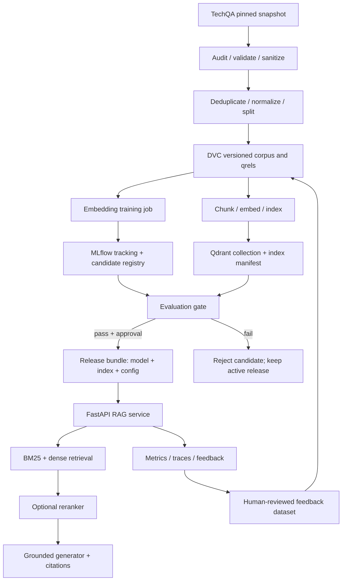

# TechQA RAG MLOps Platform — Project Specification

> **Status:** Proposed / not yet implemented  
> **Date:** 2026-11-24  
> **Primary track:** MLOps Engineer; AI Infrastructure is a later extension  
> **Compute:** Local Windows workstation + NVIDIA RTX 3060 Ti (typically 8 GB VRAM), preferably WSL2 Ubuntu  
> **Language:** Python 3.11+ (final version and dependency locks determined during Sprint 0)

## 1. Executive summary

Build a **reproducible, measurable, continuously improvable technical-support RAG system** using NVIDIA's `nvidia/TechQA-RAG-Eval` dataset. The project is *not* simply a PDF chatbot. Its central deliverable is an MLOps lifecycle for retrieval models:

1. Audit and version source data, document corpus, query–document relevance labels, chunks, and evaluation sets.
2. Establish lexical, dense, and hybrid retrieval baselines.
3. Fine-tune a small **embedding model** for technical-domain retrieval; fine-tune a **reranker** only after a trustworthy baseline.
4. Track experiments, datasets, configs, metrics, and artifacts in MLflow.
5. Apply automated quality gates before model promotion and index changes.
6. Serve a citation-grounded RAG API with model/index version metadata.
7. Monitor service health, retrieval quality proxies, and human-reviewed feedback; support rollback and candidate retraining.

**Primary learning outcome:** Demonstrate real MLOps practices—data contracts, reproducibility, evaluation, model registry, CI/CD, monitoring, and controlled continuous training—using a realistic RAG application.

**Out of scope for MVP:** Kubernetes cluster administration, distributed GPU training, autonomous production remediation, training a generator LLM, full multi-agent orchestration, and claims of production-level availability.

## 2. Problem, users, and success criteria

**Problem:** Technical-support queries often require locating precise evidence inside long documents. An off-the-shelf embedding model may underperform on domain-specific terms; a deployed retriever can degrade as documents or user queries change.

**Target user:** A support engineer or developer who asks a technical question and receives a concise answer with references to source documents/chunks.

**System behavior:**
- Search relevant technical documentation using sparse/dense retrieval.
- Optionally rerank retrieved candidates.
- Generate an answer *only* from the selected evidence, with traceable citations.
- Abstain or state insufficient evidence when retrieval is weak or query is unanswerable.
- Log non-sensitive operational metrics and feedback for future evaluation.

**Definition of success (targets; not achieved results):**
- Every published experiment traceable to dataset fingerprint, split manifest, corpus/index version, code commit, model name/revision and hyperparameters.
- No leakage between training queries and validation/test group assignments; tests remain frozen.
- At least three controlled retrieval baselines: BM25, off-the-shelf dense, hybrid.
- At least one trained embedding candidate compared on exactly the same frozen eval corpus and queries.
- Test-set quality report: Recall@1/5/10, MRR@10, nDCG@10, plus slice analysis and confidence intervals where practical.
- Promotion blocked on failed schema/security checks and pre-registered evaluation thresholds; rollback works on a recorded release bundle.
- End-to-end API responds with answer, citations, trace ID, and model/index versions.
- End-to-end demo on local hardware and reproducible setup documentation.

**Non-goal:** Guarantee that fine-tuning will beat BM25 or the base embedding model. A negative result, thoroughly measured and explained, is still a valid engineering outcome.

## 3. Dataset: NVIDIA TechQA-RAG-Eval

- Dataset: https://huggingface.co/datasets/nvidia/TechQA-RAG-Eval
- Original TechQA: https://github.com/ibm/techqa
- Dataset card lists **Apache-2.0**, states **908 question/answer pairs**, with five features: `id`, `question`, `answer`, `is_impossible`, `contexts`.
- At documentation time, the Hugging Face dataset viewer displays **910 rows** under a `train` split. The discrepancy MUST be audited from a pinned dataset revision. Do not hardcode either count as the processing invariant.
- Contexts are nested objects including `filename` and `text` in observed examples. Inspect and validate actual fields and null/empty patterns before normalizing.
- Source content concerns **IBM technical-support documentation**, not specifically MLOps tooling. Avoid misrepresenting the domain.
- Despite a Hugging Face split named `train`, the artifact is specifically presented as an **RAG evaluation dataset**. The split name does not authorize unrestricted training/evaluation on the same examples.
- Licensing metadata does not eliminate the need to honor attribution, inspect included references, and avoid exposing sensitive text in public traces.

### 3.1 Day-one data audit (mandatory)

Create `reports/dataset_audit.md` and a machine-readable JSON report containing:

- Exact dataset repository revision/commit and SHA-256 of raw export.
- Row count, unique question IDs, duplicate/near-duplicate question counts, `is_impossible` distribution.
- Number of unique context filenames and content hashes; context multiplicity per question.
- Missing/empty answer and context rates; text-length distribution and language distribution.
- Whether source filenames recur across examples; whether identical/near-identical chunks appear across different examples.
- Whether a supplied context is genuinely relevant evidence for the answer, rather than incidental context.
- Any exceptions, decontamination policy and exclusion reasons.

**Stop condition:** If relevance labels are unreliable, do not use them as ground truth for retriever fine-tuning or claim valid Recall@K. Curate a small human-reviewed relevance set first, or use a separately licensed retrieval training set while reserving TechQA for final evaluation.

### 3.2 Normalized data contracts

`documents.parquet`:

| Field | Type | Meaning |
|---|---|---|
| `doc_id` | string | Stable hash of normalized source identity/content |
| `source_filename` | string | Original context filename |
| `text` | string | Original sanitized document text |
| `content_sha256` | string | Version/de-dup key |
| `source_revision` | string | Dataset commit / version |

`chunks.parquet`:

| Field | Type | Meaning |
|---|---|---|
| `chunk_id` | string | Stable ID from `doc_id`, offsets, chunker version |
| `doc_id` | string | Parent document ID |
| `text` | string | Chunk text |
| `start_char`, `end_char` | int | Offsets in normalized parent |
| `chunker_version` | string | Versioned processing method |

`queries.parquet`:

| Field | Type | Meaning |
|---|---|---|
| `query_id` | string | Stable original ID |
| `question` | string | Query text |
| `reference_answer` | string/null | Answer for **evaluation**, never included in the retriever query |
| `is_impossible` | bool | Original flag, subject to audit |
| `split` | enum | train / val / test, generated by our pipeline |
| `group_id` | string | Leakage-prevention group |

`qrels.parquet`:

| Field | Type | Meaning |
|---|---|---|
| `query_id` | string | Query |
| `doc_id` or `chunk_id` | string | Labeled relevant evidence |
| `relevance` | int | 0 = nonrelevant, 1 = relevant; may later use graded relevance |
| `label_source` | enum | source_context / human_verified / synthetic |
| `label_confidence` | float/null | Confidence or review status; **not** a calibrated probability unless validated |

**Label rule:** Mapping every supplied `contexts[]` element to a positive label is a *candidate weak-supervision assumption*, not automatically verified gold qrels. Explicitly track provenance; report evaluation on human-reviewed labels separately.

### 3.3 Split and leakage strategy

1. Normalize, deduplicate and compute document/context content hashes **before** splitting.
2. Create query-to-source-document connected components; group related queries and duplicate/near-duplicate questions together.
3. Allocate groups into train/val/test (initial target 70/15/15, adjusted for actual viable groups). Freeze seed, assignment manifest and fingerprint.
4. Maintain a separately documented **retrieval corpus policy**: a fixed shared search corpus may contain documents across splits (as it would at deployment), but **training query–relevance supervision** must not cross query groups; never train on held-out query labels. For strict unseen-document generalization, add a second document-disjoint evaluation.
5. Keep test query text, gold context mappings, and reference answers out of model-selection prompts, synthetic generation, hard-negative mining and hyperparameter selection.
6. Track both query leakage and repeated document leakage risks; do not assert that a query-disjoint split is document-disjoint.
7. If usable training pairs are too few, use a separate permitted dataset or an explicitly labeled synthetic set generated **only from training documents**. Keep the original TechQA holdout untouched.

## 4. Product and model tasks

### 4.1 MVP task: semantic retrieval

**Input:** User question.  
**Target:** Rank evidence-bearing TechQA document chunks above irrelevant chunks.  
**Primary trainable model:** Small sentence embedding model using query-positive-document pairs; optionally hard negatives sourced from train data only.

Example (illustrative, NOT a verbatim TechQA record):

```json
{"query_id":"q_demo_01","query":"How can an application restore missing environment variables after an upgrade?","relevant_doc_ids":["doc_demo_12"]}
```

**Candidate starter model:** `sentence-transformers/all-MiniLM-L6-v2` for an English-first baseline and fine-tuning experiment. Record exact model revision and license. Use sequence truncation checks and choose an alternative if technical-document performance is inadequate. Do not assume model superiority in advance.

### 4.2 Second model: reranker (stretch / Sprint 4–5)

Input: `(question, candidate_chunk)`; output: relevance score for a candidate. Train a small CrossEncoder **only when valid positive/negative labels exist**. Compare latency/quality trade-offs with zero-shot reranking or dense-only retrieval. Do not let candidates sampled from held-out qrels enter training.

### 4.3 Generator: grounded answer (initially not fine-tuned)

Use an existing instruction model or a configurable hosted API to generate concise answers with citations. Prefer deterministic retrieval evaluation as the primary MLOps metric; generation evaluation is secondary. A failure to find supporting evidence must lead to abstention, not invented citations. For local 8 GB GPUs, use GPU sequentially for train and serve, or use a hosted generator during training experiments.

## 5. End-to-end architecture



**Two different lifecycles:** Training/registry and inference/index management. A model version and its embedding index must be promoted **together**; an embedding-model upgrade without a compatible re-embedding and reindex is invalid.

### 5.1 Component choices

| Layer | MVP choice | Role / reason |
|---|---|---|
| Python | Python 3.11+ | Consistent reproducible environment |
| Package management | `uv` or locked pip | Reproducible dependencies |
| Dataset/versioning | Hugging Face `datasets`, Pandas, DVC | Pinned input; processed datasets/artifact tracking |
| Validation | Pandera or Pydantic + pytest | Schema constraints and audit tests |
| Sparse retriever | BM25 (`rank-bm25` or equivalent) | Strong, inexpensive lexical baseline |
| Dense model | Sentence Transformers / PyTorch | Small locally trainable retriever |
| Dense index | Qdrant | Vector store and versioned collections |
| Reranker | Sentence Transformers CrossEncoder | Optional quality/latency experiment |
| Generator | Provider-neutral adapter; existing LLM | Answer generation, not central trained artifact |
| Experiment tracking | MLflow | Parameters, metrics, artifacts, model registry |
| Artifact backend | Local filesystem in MVP; MinIO optional | Durable artifact persistence |
| Serving | FastAPI + Uvicorn | Typed APIs and health probes |
| Containerization | Docker Compose | Local reproducible services |
| CI | GitHub Actions | Static, unit and non-GPU integration testing |
| Observability | Prometheus + Grafana | Latency, throughput, errors, version metrics |
| Workflow orchestration | Explicit Python CLI/Makefile first | Avoid premature orchestrator complexity |
| Later infrastructure | Kubernetes / Helm / cloud | Extension, not MVP dependency |

**Local hardware policy:** RTX 3060 Ti commonly has 8 GB VRAM. Start with small embedding models (e.g. MiniLM class), short max lengths and conservative batch sizes; watch CUDA OOM. Do not run multiple GPU-heavy jobs concurrently. Model-specific VRAM estimates must be measured, not promised.

## 6. Baseline → training → promotion experiment design

### 6.1 Baselines (fixed corpus, queries, relevance labels)

- **B0:** BM25 only.
- **B1:** Pretrained dense embedding + Qdrant.
- **B2:** Hybrid BM25+dense, fused with RRF or a documented fusion function.
- **B3:** B2 + pretrained reranker (optional).
- **C1:** Fine-tuned embedding + same retrieval configuration.
- **C2:** Fine-tuned embedding + reranker (stretch).

For fair comparisons, record all variants of chunking, index build, normalization, top-K, fusion and model revisions. Run both **frozen-index** and **properly rebuilt-index** comparisons where meaningful; never reuse vectors encoded by a different embedding model.

### 6.2 Embedding training recipe (initial hypothesis)

- Training examples: only approved `(query, positive_document)` pairs from training split.
- Loss: `MultipleNegativesRankingLoss` with verified batch composition; prevent duplicate/semantically identical positives being treated as negatives within a batch.
- Initial sweep: batch size 8 / 16 if memory allows, learning rates `2e-5` and `5e-5`, 1–3 epochs; tune on validation only.
- If reliable hard negatives exist, use a suitable loss/training format and document false-negative filtering.
- Save model, tokenizer/config, code commit, random seed, dataset/split IDs and metrics.
- Do not claim exact numeric reproducibility across all CUDA libraries; document variance across seeds.

### 6.3 Evaluation

**Retrieval metrics (primary):** Recall@1, Recall@5, Recall@10, MRR@10, nDCG@10. Use the same known-relevant-label policy and evaluate `is_impossible` cases separately. If qrels are incomplete, report pooled relevance audits and mark recall as **recall against known labels**, not exhaustive ground truth.

**Reranker:** nDCG@10 / MRR@10 over held-out candidate pools; end-to-end retrieval comparison at fixed budgets.

**Answer generation (secondary):** grounded citation precision, answer correctness against reference answers using human-reviewed samples, abstention accuracy on unanswerable questions, answer/faithfulness scores with judge methodology disclosed. Avoid treating an LLM-judge score as objective truth.

**Ops:** p50/p95 end-to-end latency, retrieval stage latency, throughput, 5xx rates, memory/RAM, GPU usage if relevant, ingestion duration and index build time.

**Slice tests:** answerable vs `is_impossible`; short/long queries; rare terminology; repeated-document groups.

### 6.4 Promotion gate (proposed thresholds, to calibrate after baseline)

A candidate is **eligible** for manual approval only if:

- Dataset provenance, leakage audit, security checks and all tests pass.
- `Recall@5(candidate) >= Recall@5(active) - 0.01` on frozen validation set.
- `nDCG@10(candidate) >= nDCG@10(active)` or an explicitly approved trade-off with measured latency benefit.
- No critical regression on unanswerable/abstention slice or structured citation validation.
- p95 latency and resource usage stay inside measured, documented operating budget.

**Important:** These are starting guardrails, not statistical guarantees. Freeze exact values *before* viewing final test performance, evaluate uncertainty, and make a deliberate go/no-go decision; never auto-promote solely because a run completed.

## 7. API contracts (initial proposal)

`POST /v1/query`

```json
{"question":"How do I fix a service configuration error?","top_k":5,"include_debug":false}
```

Response (illustrative):

```json
{
  "answer":"The cited documentation recommends checking the service configuration.",
  "citations":[{"doc_id":"doc_demo_12","chunk_id":"chunk_demo_04","source_filename":"example.txt"}],
  "retrieval":[{"chunk_id":"chunk_demo_04","score":0.81}],
  "release_id":"release_demo_01",
  "embedding_model_version":"embed_candidate_01",
  "index_version":"index_demo_01",
  "trace_id":"trace_demo_01",
  "abstained":false
}
```

Additional endpoints:

| Method | Endpoint | Access / behavior |
|---|---|---|
| GET | `/health/live` | Liveness; no GPU/model requirement |
| GET | `/health/ready` | Active model/index/config available |
| GET | `/metrics` | Prometheus metrics; restrict in deployed environments |
| POST | `/v1/feedback` | Authenticated user rating; no direct retraining |
| GET | `/v1/release` | Active bundle versions, sanitized metadata |
| POST | `/admin/promote` | Authenticated admin + gate/approval validation; stretch |
| POST | `/admin/rollback` | Authenticated admin; restore compatible release bundle; stretch |

Rate limiting, request size limits, document access control and basic prompt-injection resilience are required before exposing the system publicly.

## 8. Data/model/index lifecycle and deployment

### 8.1 Artifact identifiers

Each run records: `dataset_revision`, `raw_sha256`, `split_manifest_hash`, `chunker_version`, `embedding_model_revision`, `training_run_id`, `qdrant_collection`, `index_manifest_hash`, `retrieval_config_hash`, `generator_revision`, `git_commit`, `release_id`.

### 8.2 Release bundle (atomic deployment unit)

```yaml
release_id: release-YYYYMMDD-N
embedding_model_uri: models:/techqa-embed@candidate
embedding_model_revision: pinned-revision
qdrant_collection: techqa_embed_vN
chunker_version: chunker-v1
retrieval_config: configs/retrieval.yaml
generator_id: pinned-generator
quality_report_uri: mlflow://run-id/evaluation.json
approved_by: human-reviewer
```

A model promotion must rebuild/rebind the Qdrant index, run integration tests, switch active release atomically, retain a known-good release and verify rollback. Avoid public CI jobs that run arbitrary pull-request code with privileged access to a home workstation.

### 8.3 CI/CD/CT plan

- **CI on PR:** formatting/lint, type checks, unit tests, schema validation on tiny synthetic fixtures, security scan, deterministic offline retrieval integration test, Docker build.
- **Training (explicit trigger):** local GPU job, fixed config, DVC pull, train, eval, MLflow log; no unattended GPU jobs from untrusted PRs.
- **CD:** fetch approved model/index bundle, deploy staging, smoke test, approval, activate; rollback on failure.
- **Continuous Training:** collect reviewed feedback, increment dataset version, create *candidate* job; re-run quality gates. Never automatically update production directly from unreviewed user feedback.

## 9. Monitoring, feedback and security

**Operational monitoring:** request count, errors, p50/p95, stage-level latency, active release, retriever failures, index freshness, GPU/CPU/RAM/disk, MLflow availability.

**Quality monitoring:** human ratings, sampled citation validity, no-answer/abstention rate, query length/domain shifts, retrieval score distributions and manually labeled recurring failure categories. Unlabeled live queries alone **cannot** measure true Recall@K.

**Feedback lifecycle:** feedback → sanitize/consent check → human review → versioned labels → training candidate → validation gate → approval → release.

**Security:** log sanitization (credentials, API keys, PII), secrets in environment/secret manager, dependency scanning, prompt-injection tests, restricted admin endpoints, input size limits, no automatic command execution from retrieved text, no leaking reference answers into inference input, licenses/attribution preserved.

## 10. Repository structure (target; not yet implemented)

```text
techqa-rag-mlops/
├── PROJECT.md
├── AGENTS.md
├── README.md
├── pyproject.toml
├── uv.lock                       # generated after environment resolution
├── Makefile
├── .env.example
├── .gitignore
├── dvc.yaml
├── dvc.lock                       # generated by DVC
├── configs/
│   ├── data.yaml
│   ├── retrieval.yaml
│   ├── train_embedding.yaml
│   └── eval.yaml
├── data/
│   ├── raw/                       # DVC tracked; do not commit binaries
│   ├── processed/                 # DVC tracked
│   └── manifests/
├── src/techqa_rag/
│   ├── data/{download,audit,normalize,split,chunk}.py
│   ├── retrieval/{bm25,dense,hybrid,index}.py
│   ├── training/{embedding,reranker}.py
│   ├── evaluation/{retrieval,generation,gates}.py
│   ├── serving/{api,schemas,dependencies}.py
│   ├── tracking/mlflow_utils.py
│   └── release/{manifest,promote,rollback}.py
├── scripts/
│   ├── audit_dataset.py
│   ├── build_index.py
│   ├── evaluate.py
│   └── train_embedding.py
├── infra/
│   ├── docker-compose.yml
│   ├── Dockerfile.api
│   └── monitoring/
├── tests/{unit,integration,data,fixtures}/
├── reports/{dataset_audit,experiments}/
├── .github/workflows/{ci,release}.yml
└── docs/{architecture,decisions,runbooks}/
```

## 11. Sprint plan — 10 weeks / 5 two-week sprints

Assumption: solo developer, approximately 10–15 focused hours/week; adjust based on employment search and actual GPU throughput. Estimates are planning targets, not guaranteed delivery times.

| Week | Priority | Deliverable | Acceptance criteria |
|---|---|---|---|
| **1** | P0 | Repository setup, pinned dataset download, `dataset_audit.md`, baseline schema | Reproducible environment; audited live row count and fields; raw snapshot hashed; license citation |
| **2** | P0 | Normalized documents/chunks/queries/qrels, DVC, leakage-safe split manifest | Deterministic transforms; duplicates grouped; weak vs verified labels distinguished; unit/data tests pass |
| **3** | P0 | BM25 and dense baseline, fixed evaluation harness | Same corpus, queries, qrels; metrics reproducible; no use of held-out labels in tuning |
| **4** | P0 | Hybrid retrieval, Qdrant, retrieval API prototype | Recall@K, MRR and nDCG report; index has model/chunker fingerprint; can query with citations |
| **5** | P0 | Embedding fine-tuning on RTX 3060 Ti, MLflow experiment tracking | Successful smoke run + full run; no OOM in chosen config; artifacts and data/model revisions logged |
| **6** | P0 | Candidate-vs-baseline evaluation and quality gate | Frozen validation results, slice analysis, pass/fail report; negative result documented without hiding it |
| **7** | P1 | RAG generation, FastAPI, Docker Compose | Source-grounded answers, abstention, versioned citations; integration tests pass |
| **8** | P1 | MLflow registry, release manifest, CI and local deployment/rollback | Release index compatibility enforced; broken candidate rejected; rollback demonstrated |
| **9** | P1 | Metrics dashboard, feedback pipeline, monitoring tests | p95 latency/error dashboard; sanitized traces; reviewed feedback stored separately |
| **10** | P1 | Continuous training candidate workflow, reproducibility docs, demo | New data version → training candidate → gate → approval; README walkthrough and architecture diagram |

**Stretch after week 10:** cross-encoder reranker fine-tuning, active learning / hard-negative mining, local Kubernetes, cloud demo, LangGraph coordination, performance benchmarking and cost analysis.

### Sprint dependencies and risk gates

- **Weeks 1–2 are gating:** Dataset provenance and relevance-label validity can require a change in training strategy. Do not bypass this to begin fine-tuning.
- **Week 3 baseline is gating:** No claim of improvement without a frozen baseline.
- **Week 5 GPU gate:** If GPU OOM, reduce batch/sequence length or use a smaller embedding model; do not silently switch architecture without recording the change.
- **Week 8 gate:** Incompatible embedding/index versions must fail deployment.
- **Week 10 gate:** Training completion never implies automatic production promotion.

### Suggested estimation

- Data audit, labeling and leakage handling: **20–30 h**
- Baselines, retrieval, evaluation: **20–30 h**
- Fine-tuning and tracking: **20–30 h**
- Serving, release, CI/CD: **25–35 h**
- Monitoring, documentation, demo: **15–25 h**

Total rough effort **100–150 h**, excluding unexpected dataset cleanup and complex GPU issues. If time is limited, prioritize P0 deliverables and postpone reranker + elaborate generator UI.

## 12. Week 1 implementation checklist

- [ ] Create repository and commit `PROJECT.md`, `AGENTS.md`, README, license notice and basic Python package structure.
- [ ] Confirm Windows/WSL2 GPU access (`nvidia-smi`), Python and PyTorch CUDA compatibility; note installed versions in `docs/environment.md`.
- [ ] Add `pyproject.toml`, lockfile, Ruff, pytest, pre-commit hooks and a minimal CI workflow.
- [ ] Write `scripts/audit_dataset.py` that loads `nvidia/TechQA-RAG-Eval` at an explicit pinned revision.
- [ ] Check actual schema, lengths, nulls, duplicate IDs, repeated contexts and `is_impossible`; generate JSON + Markdown audit reports.
- [ ] Save dataset/source metadata, revision, content fingerprint and Apache-2.0 attribution.
- [ ] Add tiny **synthetic** fixtures for CI instead of downloading the full benchmark on every PR.
- [ ] Define label-quality review protocol and stop/go decision before training.

**Week 1 demonstration:** `make audit-data` generates deterministic counts and clear alerts for broken schema or duplicated IDs; any unverified assumptions are surfaced explicitly.

## 13. Definition of Done (applies to each feature)

A feature is done only when it has: functioning code; tests; reproducible command; logged config/version; relevant documentation; explicit error behavior; no hardcoded secrets; and a brief proof (artifact, screenshot or test report). A README claim without working implementation is **not** accepted as completed work.

## 14. Resume / portfolio evidence

Present an actual benchmark table, not invented numbers. Show:

- Model A/B/C retrieval quality at identical evaluation conditions.
- MLflow screenshot or exported run comparisons.
- Dataset lineage and split/label audit.
- CI job links, failure-case tests, and release rollback demo.
- Dashboard snapshot with p95 latency and error rate.
- Clear explanations of constraints of 8 GB VRAM and why the serving architecture was chosen.

## 15. Sources and implementation references

- NVIDIA TechQA-RAG-Eval dataset card, observed fields, licensing and record-count discrepancy: https://huggingface.co/datasets/nvidia/TechQA-RAG-Eval
- Original IBM TechQA repository: https://github.com/ibm/techqa
- Sentence Transformers training and evaluators: https://sbert.net/docs/sentence_transformer/training_overview.html
- Sentence Transformers loss choices: https://sbert.net/docs/package_reference/sentence_transformer/losses.html
- CrossEncoder training documentation: https://sbert.net/docs/cross_encoder/training_overview.html
- MLflow docs: https://mlflow.org/docs/latest/ml/
- DVC docs: https://dvc.org/doc
- Qdrant docs: https://qdrant.tech/documentation/
- FastAPI docs: https://fastapi.tiangolo.com/
- NVIDIA CUDA on WSL: https://docs.nvidia.com/cuda/wsl-user-guide/index.html

> **Provenance note:** Dataset fields, card license, 908-card-versus-910-viewer discrepancy were checked against the public dataset page on 2026-11-24. All architecture diagrams, initial thresholds, week estimates, schemas, and example values above are **proposed project design**, not claims that code or results already exist.


## Execution and progress control (2026-11-24 addendum)

For granular implementation order, per-task commands, acceptance gates and weekly deliverables, follow [`EXECUTION_GUIDE.md`](EXECUTION_GUIDE.md). The **single source of truth for current progress** is [`TASK_TRACKER.md`](TASK_TRACKER.md). Do not start a second task before updating the active task with observed test evidence.
